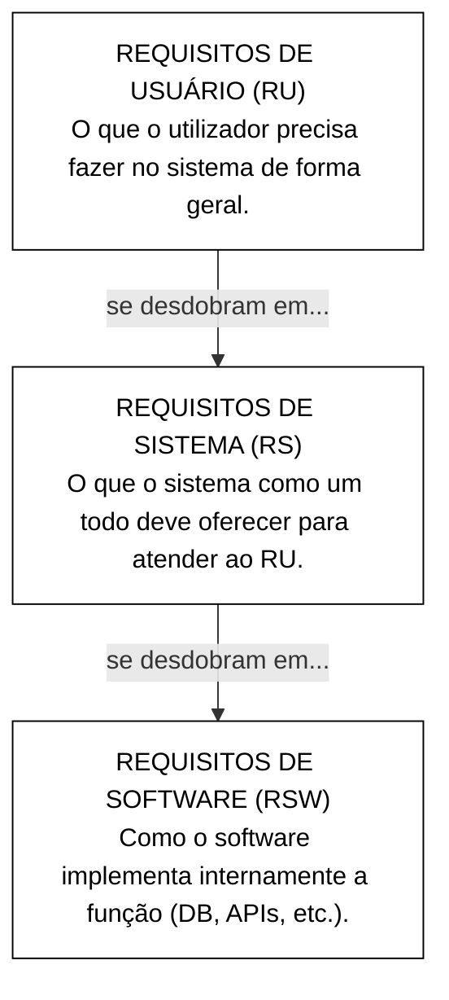
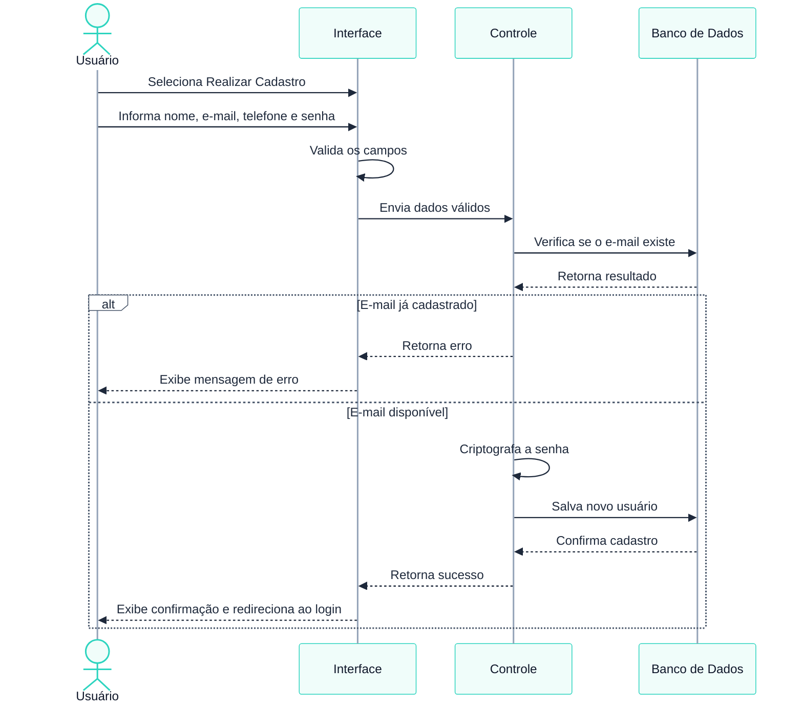
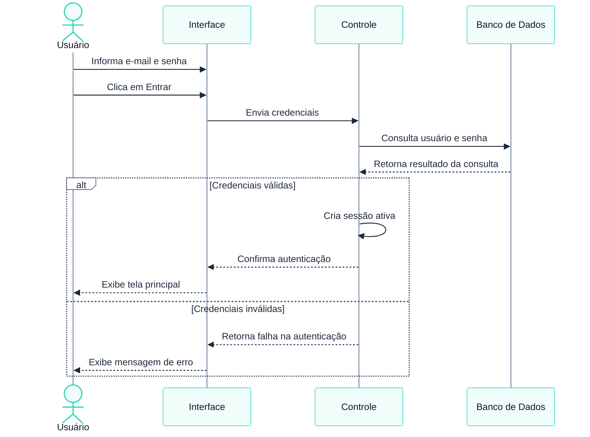
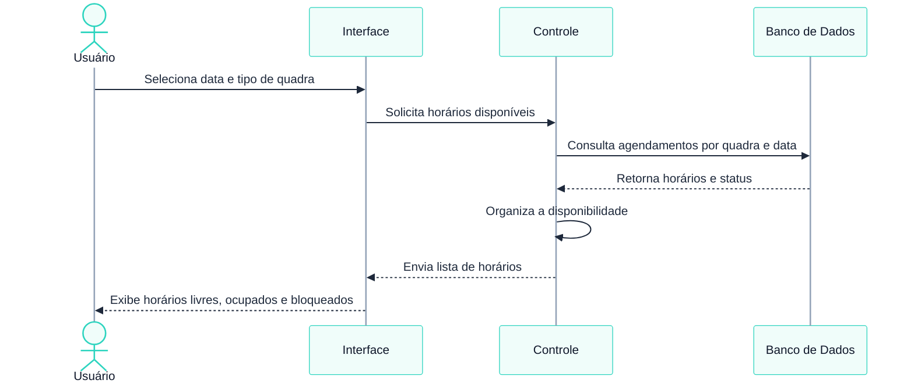
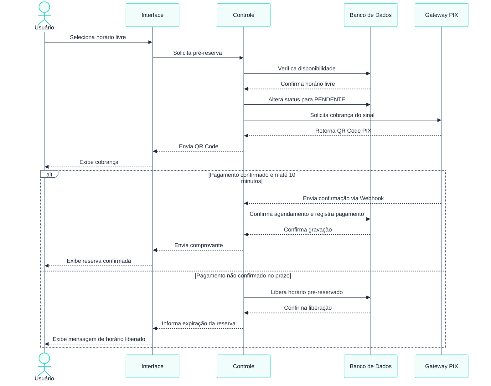
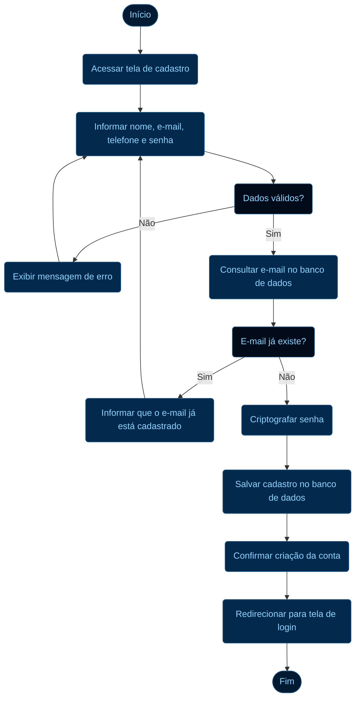
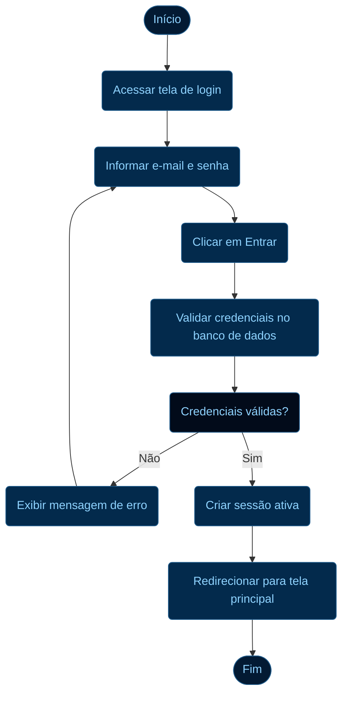
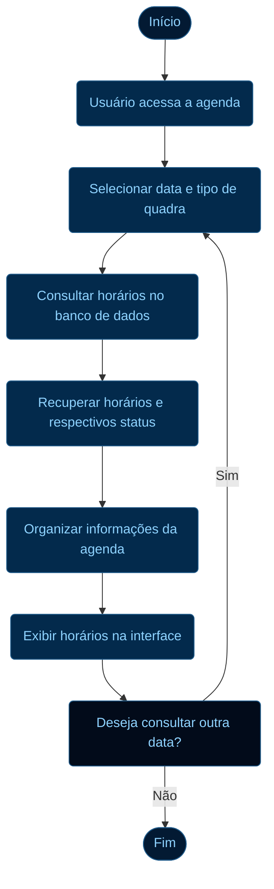
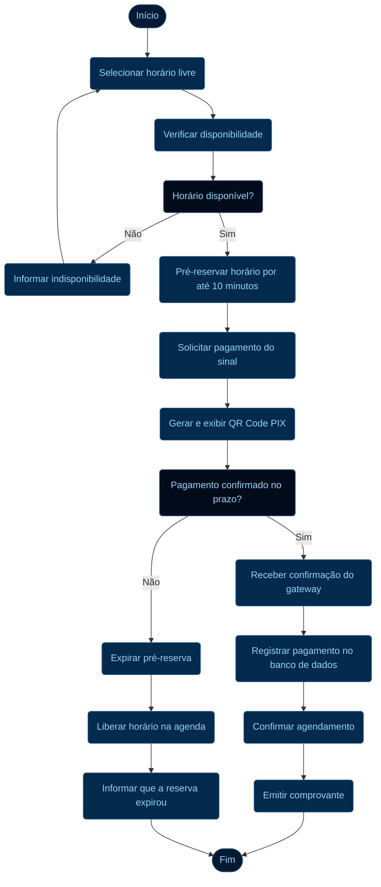

[README.md](https://github.com/user-attachments/files/35375767/README.md)
# ArenaSports
Software de aluguel de quadras esportivas.
# ArenaSports — Documento de Engenharia de Requisitos

> Universidade Federal do Amazonas (UFAM) · Instituto de Ciências Exatas e Tecnologia (ICET) · Engenharia de Software · Itacoatiara/AM · 2026

---

## Ficha Técnica

### Equipe responsável pela elaboração

- Paulo Davi de Sousa Domingues
- Ryan Salvador Corrêa

### Público-alvo

Este manual destina-se a todos os colaboradores que estejam inseridos na execução do projeto, bem como ao cliente que receberá o produto final.

### Registro de alterações

| Versão | Responsável | Data | Alterações |
|:------:|-------------|:----:|------------|
| 1.0 | Ryan Salvador Corrêa | 30/09/2026 | Estruturação inicial do documento, levantamento de RF, RNF e RN. |
| 1.1 | Ryan Salvador Corrêa | 06/10/2026 | Construção do diagrama de caso de uso. |
| 1.2 | Paulo Davi de Sousa | 06/10/2026 | Construção dos diagramas de sequência e atividade. |
| 1.3 | Paulo Davi de Sousa / Luan Hideki Oda / Ryan Salvador Corrêa | 08/10/2026 | Revisão final. |

---

## Sumário

1. [Introdução](#1-introdução)
    - [1.1. Estrutura/Visão Geral do Documento](#11-estruturavisão-geral-do-documento)
    - [1.2. Audiência do Documento](#12-audiência-do-documento)
    - [1.3. Convenções, Termos e Abreviações](#13-convenções-termos-e-abreviações)
    - [1.4. Descrição Geral do Sistema](#14-descrição-geral-do-sistema)
    - [1.5. Descrição dos Usuários](#15-descrição-dos-usuários)
2. [Requisitos Gerais do Sistema](#2-requisitos-gerais-do-sistema)
    - [2.1. Requisitos Funcionais](#21-requisitos-funcionais)
    - [2.2. Requisitos Não-Funcionais](#22-requisitos-não-funcionais)
    - [2.3. Regras de Negócio](#23-regras-de-negócio)
3. [Histórias de Usuário (User Story)](#3-histórias-de-usuário-user-story)
4. [Perspectivas / Níveis de Detalhamento](#4-perspectivas--níveis-de-detalhamento)
    - [4.1. Requisitos de Usuário](#41-requisitos-de-usuário)
    - [4.2. Requisitos de Sistema](#42-requisitos-de-sistema)
    - [4.3. Requisitos de Software](#43-requisitos-de-software)
5. [Diagramas UML](#5-diagramas-uml)
    - [5.1. Diagrama de Caso de Uso](#51-diagrama-de-caso-de-uso)
    - [5.2. Especificação de Casos de Uso](#52-especificação-de-casos-de-uso)
    - [5.3. Diagrama de Sequência](#53-diagrama-de-sequência)
    - [5.4. Diagrama de Atividades](#54-diagrama-de-atividades)

---

## 1. Introdução

### 1.1. Estrutura/Visão Geral do Documento

Esta introdução fornece as informações necessárias para fazer um bom uso deste documento, explicitando seus objetivos e as convenções que foram adotadas no texto. As demais seções apresentam a especificação do sistema **ArenaSports** e estão organizadas como descrito abaixo:

- **Introdução:** apresenta a visão geral, público-alvo, siglas e perfil dos usuários.
- **Requisitos Gerais do Sistema:** define os Requisitos Funcionais (RF), Não-Funcionais (RNF) e Regras de Negócio (RN).
- **Histórias de Usuário:** apresenta os requisitos em formato ágil (User Stories).
- **Perspectivas / Níveis de Detalhamento:** desdobra os requisitos nas visões de Usuário (RU), Sistema (RS) e Software (RSW).
- **Diagramas UML:** apresenta as modelagens visuais e especificações de casos de uso, sequência e atividades.

### 1.2. Audiência do Documento

| Seção | Público principal | Linguagem / Foco |
|-------|-------------------|------------------|
| Introdução e Objetivos | Cliente / Usuário | Linguagem simples, foco em propósito e valor do sistema. |
| Descrição Geral | Cliente / Usuário / Gestor | Descreve o que o sistema faz e o que não faz. |
| Requisitos Funcionais (RF) | Desenvolvedores / Testadores | Detalha funções, fluxos e regras operacionais. |
| Requisitos Não-Funcionais (RNF) | Desenvolvedores / Testadores | Desempenho, segurança, usabilidade, etc. |
| Regras de Negócio / Glossário | Todos | Linguagem comum e definição de termos do negócio. |
| Critérios de Aceitação / User Stories | Testadores / Clientes | Validação e verificabilidade funcional. |
| Modelos e Diagramas (UC, Sequência, Atividades) | Desenvolvedores | Representação técnica e arquitetural. |

*Tabela 1 – Audiência do Documento*

### 1.3. Convenções, Termos e Abreviações

| Sigla | Significado |
|-------|-------------|
| RF | Requisito Funcional |
| RNF | Requisito Não-Funcional |
| RN | Regra de Negócio |
| RU | Requisito de Usuário |
| RS | Requisito de Sistema |
| RSW | Requisito de Software |
| UC | Caso de Uso (*Use Case*) |
| PIX | Pagamento Instantâneo Brasileiro |

### 1.4. Descrição Geral do Sistema

O sistema ArenaSports é uma plataforma voltada à automação e gestão de agendamentos de quadras esportivas (society, areia e poliesportivas). O sistema resolve o problema do choque de horários e da informalidade em reservas, permitindo que atletas visualizem agendas em tempo real, realizem reservas via PIX e que os administradores controlem o caixa e bloqueiem horários para manutenção.

### 1.5. Descrição dos Usuários

Os usuários desse sistema podem ser classificados em:

1. **Atleta / Cliente:** atletas locais que desejam consultar horários disponíveis, realizar reservas de quadras e contratar materiais adicionais (coletes, bolas).
2. **Atendente / Administrador:** responsável por gerenciar as quadras, validar reservas efetuadas presencialmente/balcão, bloquear horários para manutenção e emitir relatórios de faturamento.

---

## 2. Requisitos Gerais do Sistema

### 2.1. Requisitos Funcionais

| Identificador | Descrição | Escopo | Prioridade |
|:-------------:|-----------|:------:|:----------:|
| RF01 | O sistema deve permitir que o usuário crie um cadastro informando nome, e-mail, telefone e senha. | Geral | Essencial |
| RF02 | O sistema deve permitir o acesso do usuário por meio de login com e-mail e senha. | Geral | Essencial |
| RF03 | O sistema deve exibir a grade de horários disponíveis e ocupados por data e quadra. | Agendamento | Essencial |
| RF04 | O sistema deve permitir a reserva de um horário mediante confirmação de pagamento do sinal. | Agendamento | Essencial |
| RF05 | O sistema deve permitir que o usuário inclua aluguel de materiais adicionais (coletes, bolas) na reserva. | Agendamento | Desejável |
| RF06 | O sistema deve permitir que o usuário solicite o cancelamento de uma reserva realizada. | Agendamento | Importante |
| RF07 | O sistema deve permitir que o administrador bloqueie horários da agenda para manutenção. | Administração | Importante |
| RF08 | O sistema deve permitir a saída do usuário (logout). | Geral | Importante |

*Tabela 2 – Requisitos Funcionais (RF)*

### 2.2. Requisitos Não-Funcionais

| Identificador | Descrição | Categoria | Escopo | Prioridade |
|:-------------:|-----------|:---------:|:------:|:----------:|
| RNF01 | O sistema deve criptografar todas as senhas dos usuários. | Segurança | Geral | Essencial |
| RNF02 | O sistema deve processar as consultas de disponibilidade e respostas da agenda em até 2 segundos. | Desempenho | Agendamento | Importante |
| RNF03 | O sistema deve disponibilizar interface totalmente responsiva para navegação em dispositivos móveis. | Usabilidade | Geral | Essencial |
| RNF04 | O sistema deve oferecer tema escuro opcional para melhor experiência do usuário. | Usabilidade | Geral | Desejável |

*Tabela 3 – Requisitos Não-Funcionais (RNF)*

### 2.3. Regras de Negócio

| Identificador | Descrição | Escopo | Prioridade |
|:-------------:|-----------|:------:|:----------:|
| RN01 | A reserva online de uma quadra só é confirmada mediante o pagamento prévio de no mínimo 50% do valor do horário. | Agendamento | Essencial |
| RN02 | Cancelamentos de reservas com direito a reembolso ou crédito só podem ser efetuados com até 6 horas de antecedência do horário agendado. | Agendamento | Importante |
| RN03 | O mesmo horário de uma quadra não pode ser reservado por dois clientes simultaneamente. | Agendamento | Essencial |
| RN04 | O horário selecionado fica pré-reservado por 10 minutos; caso o pagamento não seja concluído nesse período, a vaga é liberada automaticamente para a agenda. | Agendamento | Importante |
| RN05 | Clientes que realizarem mais de 5 reservas no mesmo mês recebem 10% de desconto no valor do próximo agendamento. | Financeiro | Desejável |

*Tabela 4 – Regras de Negócio (RN)*

---

## 3. Histórias de Usuário (User Story)

<table>
  <tr>
    <td><b>Título</b>: Realizar Login (RF02)</td>
    <td><b>Prioridade</b>: Essencial</td>
    <td><b>Estimativa</b>: 8 pontos</td>
  </tr>
  <tr>
    <td colspan="3">
      
<b>História de Usuário</b>

      
<b>Como:</b> Atleta / Usuário do sistema

      
<b>Eu quero:</b> Acessar o sistema por meio de login

      
<b>Para:</b> Utilizar as funcionalidades de agendamento de forma segura e personalizada

    </td>
  </tr>
  <tr>
    <td colspan="3">
      
<b>Critério de Aceitação</b>:

      <ol><li>O usuário deve informar e-mail e senha válidos.</li><li>O sistema deve autenticar em até 2 segundos.</li><li>Mensagem de erro deve ser exibida em caso de credenciais inválidas.</li></ol>
    </td>
  </tr>
</table>

<i>Tabela 5 – User Story de Realizar Login (RF02)</i>

<table>
  <tr>
    <td><b>Título</b>: Reservar Quadra (RF04)</td>
    <td><b>Prioridade</b>: Essencial</td>
    <td><b>Estimativa</b>: 13 pontos</td>
  </tr>
  <tr>
    <td colspan="3">
      
<b>História de Usuário</b>

      
<b>Como:</b> Atleta

      
<b>Eu quero:</b> Selecionar uma data, hora livre e tipo de quadra e efetuar o pagamento do sinal

      
<b>Para:</b> Garantir o meu horário de futebol com meus amigos sem choque de agenda

    </td>
  </tr>
  <tr>
    <td colspan="3">
      
<b>Critério de Aceitação</b>:

      <ol><li>A agenda deve indicar em verde os horários vagos e em vermelho os ocupados.</li><li>Ao clicar no horário, o sistema deve segurar a vaga por até 10 minutos para conclusão do PIX.</li><li>O comprovante e QR Code da reserva devem ser gerados imediatamente após confirmação do pagamento.</li></ol>
    </td>
  </tr>
</table>

<i>Tabela 6 – User Story de Reservar Quadra (RF04)</i>

<table>
  <tr>
    <td><b>Título</b>: Cancear Reserva (RF06)</td>
    <td><b>Prioridade</b>: Importante</td>
    <td><b>Estimativa</b>: 5 pontos</td>
  </tr>
  <tr>
    <td colspan="3">
      
<b>História de Usuário</b>

      
<b>Como:</b> Atleta com reserva ativa

      
<b>Eu quero:</b> Solicitar o cancelamento do meu agendamento pelo próprio aplicativo

      
<b>Para:</b> Liberar o horário e reaver o meu dinheiro/crédito caso aconteça um imprevisto

    </td>
  </tr>
  <tr>
    <td colspan="3">
      
<b>Critério de Aceitação</b>:

      <ol><li>O sistema deve verificar se a solicitação cumpre o prazo mínimo de 6 horas da RN02.</li><li>Se aprovado, altera o status da reserva para "Cancelado" e libera o horário no calendário.</li><li>Exibe mensagem avisando que o valor foi convertido em cupom/estorno.</li></ol>
    </td>
  </tr>
</table>

<i>Tabela 7 – User Story de Cancelar Reserva (RF04)</i>

---

## 4. Perspectivas / Níveis de Detalhamento

*Figura 1 – Relacionamento entre RU, RS e RSW*

### 4.1. Requisitos de Usuário

| Identificador | Descrição |
|:-------------:|-----------|
| RU01 | O usuário deve poder consultar a disponibilidade de horários e agendar uma quadra esportiva. |
| RU02 | O usuário deve poder solicitar o cancelamento de um agendamento efetuado. |

*Tabela 8 – Requisitos de Usuário (RU)*

### 4.2. Requisitos de Sistema

| Identificador | Descrição | Requisitos relacionados |
|:-------------:|-----------|:-----------------------:|
| RS01 | O sistema deve exibir um calendário interativo com a grade de horários livres e ocupados por data e quadra, permitindo selecionar um horário para pré-reserva. | RU01 |
| RS02 | O sistema deve permitir que o usuário confirme o agendamento mediante a geração de cobrança do sinal via PIX e validação do pagamento. | RU01 |
| RS03 | O sistema deve permitir que o usuário selecione uma reserva ativa e solicite seu cancelamento, validando as regras de antecedência antes de alterar o status. | RU02 |

*Tabela 9 – Requisitos de Sistema (RS)*

### 4.3. Requisitos de Software

| Identificador | Descrição | Requisitos relacionados |
|:-------------:|-----------|:-----------------------:|
| RSW01 | O software deve executar uma consulta SQL na tabela `agendamentos` combinando `id_quadra`, `data` e `hora_inicio` para filtrar os slots no estado `'LIVRE'` e exibi-los na interface gráfica. | RS01 |
| RSW02 | O software deve aplicar uma trava temporária de 10 minutos no registro do slot selecionado alterando a coluna `status` para `'PENDENTE'` enquanto aguarda a resposta do meio de pagamento. | RS01 |
| RSW03 | O software deve integrar-se com a API do gateway de pagamento para emitir o QR Code dinâmico e escutar o callback (Webhook) de confirmação da transação. | RS02 |
| RSW04 | O software deve atualizar a coluna `status` para `'CONFIRMADO'` e gravar a transação financeira na tabela `pagamentos` após o retorno positivo do Webhook. | RS02 |
| RSW05 | O software deve calcular a diferença entre o horário atual da requisição e o horário de início da reserva, permitindo o cancelamento apenas se a diferença for maior ou igual a 6 horas. | RS03 |
| RSW06 | O software deve alterar a coluna `status` do agendamento para `'CANCELADO'` no banco de dados e liberar a restrição de unicidade do horário para novas buscas. | RS03 |

*Tabela 10 – Requisitos de Software (RSW)*

---

## 5. Diagramas UML

### 5.1. Diagrama de Caso de Uso

  

<i>Figura 2 – Diagrama de Caso de Uso.</i>

### 5.2. Especificação de Casos de Uso

#### UC1 – Cadastrar

| Campo | Descrição |
|-------|-----------|
| **Nome do caso de uso** | UC1 – Cadastrar |
| **Caso de uso geral** | Fluxo Principal |
| **Ator principal** | Atleta / Usuário |
| **Atores secundários** | N/A |
| **Resumo** | Este caso de uso descreve as etapas para a criação de uma nova conta de usuário na aplicação ArenaSports. |
| **Pré-condições** | O usuário deve ter acesso à internet e informar os dados obrigatórios corretamente. |
| **Pós-condições** | Se os dados forem válidos, o cadastro é efetivado no banco de dados e o usuário é redirecionado à tela de login. |
| **Restrições/Validações** | Se os dados forem inválidos ou o e-mail já estiver em uso, o cadastro não será efetivado e uma mensagem de erro será exibida. |

| Ações do Ator | Ações do Sistema |
|---------------|------------------|
| 1 – Clicar na opção "Realizar Cadastro" | |
| 2 – Informar os dados obrigatórios (Nome, E-mail, Telefone e Senha) | |
| | 3 – Validar o formato das informações e verificar se o e-mail já existe no sistema |
| | 4 – Criptografar a senha e armazenar o cadastro no banco de dados |
| | 5 – Confirmar a criação da conta e redirecionar para a tela de Login |

*Tabela 11 – Especificação do caso de uso Cadastrar*

#### UC2 – Logar

| Campo | Descrição |
|-------|-----------|
| **Nome do caso de uso** | UC2 – Logar |
| **Caso de uso geral** | Fluxo Principal |
| **Ator principal** | Atleta / Usuário |
| **Atores secundários** | N/A |
| **Resumo** | Este caso de uso descreve o fluxo de autenticação para acesso às funcionalidades restritas do sistema. |
| **Pré-condições** | O usuário deve ter acesso à internet e possuir cadastro prévio no sistema. |
| **Pós-condições** | Se as credenciais forem válidas, o usuário é autenticado e redirecionado para a tela principal (Home). |
| **Restrições/Validações** | Se as credenciais forem incorretas, o login não será efetivado e uma mensagem de erro será exibida. |

| Ações do Ator | Ações do Sistema |
|---------------|------------------|
| 1 – Inserir as credenciais nos campos destinados (E-mail e Senha) | |
| 2 – Clicar no botão "Entrar" | |
| | 3 – Validar as credenciais no banco de dados |
| | 4 – Confirmar a autenticação do usuário e gerar a sessão ativa |
| | 5 – Redirecionar para a interface principal da aplicação |

*Tabela 12 – Especificação do caso de uso Logar*

#### UC3 – Consultar Horários

| Campo | Descrição |
|-------|-----------|
| **Nome do caso de uso** | UC3 – Consultar Horários |
| **Caso de uso geral** | Fluxo Principal |
| **Ator principal** | Atleta / Usuário |
| **Atores secundários** | N/A |
| **Resumo** | Este caso de uso descreve a consulta à grade de horários disponíveis, ocupados e bloqueados das quadras. |
| **Pré-condições** | O usuário deve estar logado na aplicação. |
| **Pós-condições** | O sistema exibe a disponibilidade atualizada da quadra na data selecionada. |
| **Restrições/Validações** | N/A |

| Ações do Ator | Ações do Sistema |
|---------------|------------------|
| 1 – Selecionar a data e o tipo de quadra desejada | |
| | 2 – Consultar no banco de dados os horários cadastrados e seus respectivos status |
| | 3 – Renderizar na interface a lista de horários com indicação de disponibilidade |

*Tabela 13 – Especificação do caso de uso Consultar Horários*

#### UC3 – Reservar Quadra

| Campo | Descrição |
|-------|-----------|
| **Nome do caso de uso** | UC3 – Reservar Quadra |
| **Caso de uso geral** | Fluxo Alternativo Principal |
| **Ator principal** | Atleta / Usuário |
| **Atores secundários** | Gateway de Pagamento (PIX) |
| **Resumo** | Este caso de uso descreve a seleção de um horário vago e a confirmação do agendamento mediante pagamento do sinal. |
| **Pré-condições** | - O usuário deve estar logado no sistema - O sistema deve ter executado a verificação de disponibilidade |
| **Pós-condições** | O horário reservado passa para o status "Confirmado" e fica indisponível para outros usuários. |
| **Restrições/Validações** | Se o pagamento não for efetuado no prazo limite de 10 minutos, a trava do horário expira e o slot é liberado novamente na agenda. |

| Ações do Ator | Ações do Sistema |
|---------------|------------------|
| 1 – Selecionar um horário vago na grade de horários | |
| | 2 – Aplicar a trava temporária de 5 minutos no horário selecionado |
| 3 – Confirmar a intenção de reserva e solicitar o pagamento do sinal | |
| | 4 – Gerar e exibir o QR Code do PIX integrado ao gateway de pagamento |
| | 5 – Confirmar o recebimento do pagamento via Webhook |
| | 6 – Gravar a reserva no banco de dados e alterar o status do slot para "Ocupado" |
| | 7 – Emitir o comprovante de agendamento na tela |

*Tabela 14 – Especificação do caso de uso Reservar Quadra*

### 5.3. Diagrama de Sequência

#### Figura 3 – Cadastrar

#### Figura 4 – Logar

#### Figura 5 – Consulta de horários

#### Figura 6 – Reserva

### 5.4. Diagrama de Atividades

#### Figura 7 – Cadastro

#### Figura 8 – Logar

#### Figura 9 – Consultar Horários

#### Figura 10 – Reservas

